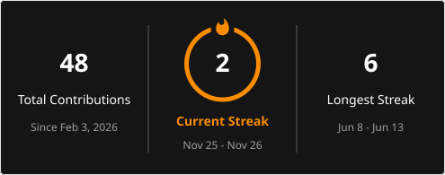

# 💫 About Me:
## 🌙 About Me  - 🔭 Exploring Development - 🌱 Practicing DSA - 🤝 Open to Collaborations

## 🌐 Socials:
  

# 💻 Tech Stack:
                           

## 📊 GitHub Statistics

 

## 🏆 GitHub Trophies

<!-- Proudly created with GPRM ( https://gprm.itsvg.in ) -->
